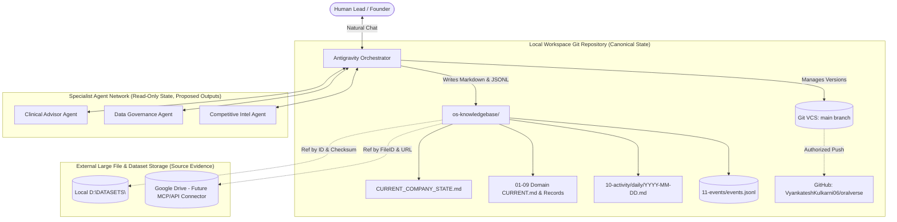

# System Map — Architecture, Storage Boundaries, and Integrations

> **Scope:** Defines the technical topology of the Company Operating System, storage responsibilities, authorization boundaries, and integration mechanics.

---

## 1. Storage Boundaries & Topology

---

## 2. Storage Responsibility Matrix

| Asset Type | Storage Target | Format | Retention & Versioning | Access Level |
| :--- | :--- | :--- | :--- | :--- |
| **Canonical Knowledge & Policies** | Git (`os-knowledgebase/`) | Markdown | Versioned via Git commits | Internal Team / Agents |
| **Task Records & Roadmaps** | Git (`08-execution/`) | Markdown tables + Stable IDs | Versioned via Git commits | Internal Team / Agents |
| **Decisions (ADRs)** | Git (`09-decisions/`) | Markdown (`DEC-xxx.md`) | Append-only / Superseded status | Internal Team / Agents |
| **Activity History** | Git (`10-activity/daily/`) | Markdown (`YYYY-MM-DD.md`) | Daily append | Internal Team / Agents |
| **Transaction Event Stream** | Git (`11-events/`) | Append-only JSONL (`events.jsonl`)| Tamper-evident append-only | System Orchestrator |
| **Raw Datasets & Scans** | Local Disk / Google Drive | Raw ZIP, TAR, RAR, DICOM, JPG | Checksummed (`SHA-256`), ID ref | Restricted / Local |
| **Clinical Validation Data** | Google Drive / Secure Share | Spreadsheets, Raw Metrics | Stored in Drive, linked via ID | Restricted / Clinical Lead |
| **Financial Forecasts** | Git (`07-finance/`) / Restricted | Markdown Summary / Sheets | Restricted domain in Git/Drive | Founder / Restricted |

---

## 3. Integration & Connector Status

| Integration | Current Status | Mechanism | Verification Evidence | Notes / Blockers |
| :--- | :--- | :--- | :--- | :--- |
| **Local Git VCS** | **Active & Verified** | Native `git` CLI (v2.x) | Commit history on `main`, remote configured | Clean working tree management enforced |
| **GitHub Remote** | **Configured** | `https://github.com/VyankateshKulkarni06/oralverse.git` | Verified via `git remote -v` | Push requires user credentials / token |
| **Google Drive Connector** | **Missing / Not Configured** | N/A (No active MCP server or gdrive CLI) | `mcp_config.json` is empty; no drive mount | Reference files via Drive File IDs; see [`INTEGRATION_STATUS.md`](../INTEGRATION_STATUS.md) |
| **Local Datasets Storage** | **Available** | File system path `D:\DATASETS` | Verified via directory listing | Contains D04, D05, D06, D09, Mendeley datasets |
| **Antigravity Customizations**| **Active** | Workspace `.agents/` + `AGENTS.md` | Built-in IDE agent system | Progressive skill activation and rules |

---

## 4. One-Writer Coordination Model

1. **Sole State Writer**: Only the primary Antigravity Orchestrator has write permission to `os-knowledgebase/` and canonical Git commits.
2. **Specialist Subagents**:
   - May run parallel tasks (e.g., deep search, clinical literature review, dataset license checks).
   - Must output structured findings with citations and confidence ratings back to the Orchestrator.
   - May **not** directly commit to Git or overwrite shared state files.
3. **Conflict Prevention**:
   - Stable IDs prevent duplicate key allocation.
   - Updates are atomic: event logged + record updated + snapshot reconciled + Git committed in a single logical transaction.
